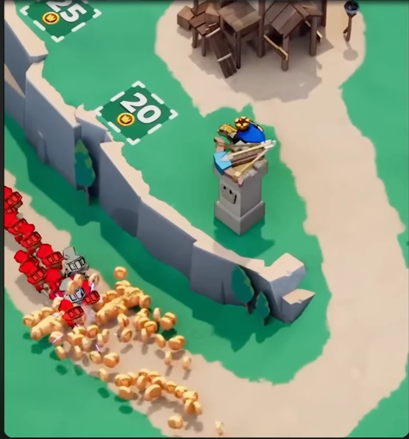

# Kingshot — Hold the Keep

A recreation of the minigame Kingshot (Century Games) actually opens with: a Thronefall-style
real-time defense. You march the king, a silver plate knight, along a sandy road between grey cliffs, your gold
follows you as a trail of coins, you stand on green price signs to pay for hero towers,
palisades, farms and barracks, and then you hold the road through the night while raiders
march on the keep. Three waves in the first few minutes, more on later levels.

<p align="center"></p>

Reading the reference frame: the orange blob is the coin trail behind the player, the green
squares marked 20 and 25 with a coin icon are build-site prices, the hero on the stone pillar
is a built tower, the red column is the player's own knights following the silver-armoured king, and the orange round creatures with pink hit-sparks around them are the enemy horde.

## Play it in a browser

The browser build is the current version of the game and lives in
[`web/index.html`](web/index.html), published at
**https://claude.ai/artifact/DksLCaJZkScSABvMM6zN1C**. One HTML file, no build step.

| Action | Result |
|---|---|
| Drag anywhere (or WASD / arrows) | March the king; your knights and your gold follow |
| Ride over coins | Pick them up; they join the trail |
| Stand on a price sign | Coins fly from your trail into the site until it is built |
| Hero Tower (25) | Archer on a pedestal, shoots raiders in range |
| Palisade (15) | Blocks the road until raiders batter it down; repaired each morning |
| Farm (10) | More gold at the gate every morning |
| Barracks (20) | Five soldiers who follow you and fight; replenished each morning |
| "Call the night" | Starts the next wave early; otherwise the day timer runs out |

The king fights whatever comes within reach of his sword. If he falls he returns at the gate
after four seconds. Lose the keep and the level is lost; break every wave and you move on.

An earlier build, a crowd-runner through number gates, is kept as
[`web/road-runner.html`](web/road-runner.html).

## Running the iOS app

The SpriteKit app under `Kingshot/` is still the earlier crowd-runner design and has not yet
been brought in line with the keep-defense game above.

1. Open `Kingshot.xcodeproj` in Xcode 16 or newer (the project uses file-system-synchronised
   groups, so new files dropped into `Kingshot/` or `KingshotTests/` are picked up
   automatically).
2. Select the `Kingshot` scheme and an iPhone simulator or device, then **Run**.
3. For a device build, set your team under *Signing & Capabilities*.

Run the unit tests with **Product ▸ Test** (⌘U). They cover the rules engine, the level
generator and the track geometry, including a greedy pilot that proves the first 25
generated levels are winnable and that passive play is not enough.

## How to play

| Action | Result |
|---|---|
| Tap | Start the level |
| Hold and drag left / right | Steer the army across the road |
| Green gate (`+20`, `x2`) | Adds to or multiplies your headcount |
| Red gate (`-15`, `÷2`) | Shrinks your headcount |
| Red formation | One-for-one battle; win it by outnumbering them |
| Hero pedestal | Fires at any formation within range, before and during a fight |
| Boss at the keep | Finish with more soldiers than the boss to clear the level |

Coins are earned for every formation destroyed and every soldier that survives. Progress is
stored on-device.

## Project layout

```
Kingshot/
  App/        SwiftUI entry point, on-device progress store
  Core/       Pure-Swift rules engine (no UIKit): models, seeded RNG, track spline,
              level generator, GameSimulation
  Game/       SpriteKit presentation: scene, nodes, textures drawn with Core Graphics,
              HUD, terrain builder
  Assets.xcassets
KingshotTests/  XCTest suites for Core
web/            Browser port: one HTML file, canvas renderer, same rules and generator
docs/           Design notes reconstructed from the reference footage
```

The simulation is deliberately separated from rendering. `GameSimulation.update(dt:)`
returns a list of `SimEvent`s (gate passed, battle started, units traded, hero fired, won,
lost) and `GameScene` turns those into animation. Every level is generated deterministically
from its number, and the generator sizes each obstacle by replaying the level so far with a
greedy pilot, so difficulty is measured rather than guessed.

See [`docs/GAME_DESIGN.md`](docs/GAME_DESIGN.md) for the breakdown of the original game's
mechanics and how each one is implemented here.
